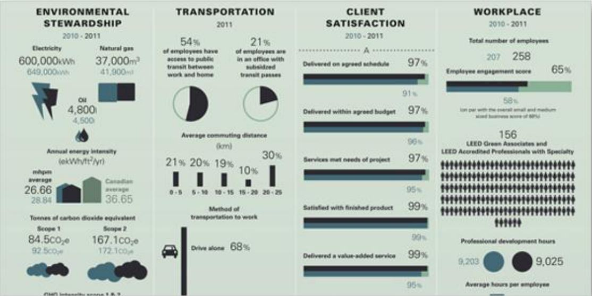

# 分栏指标图

## 来源

《第三讲-信息图形类型学》PDF 第 22 页，按课件标注归类。图片保留案例图版区域。

## 数据结构

每行一项指标，记录栏目、指标、数值与单位。 这些字段用于分析和复现图形。

## 图形与阅读方式

分栏承载主题，扇区和水平条表达比例，象形符号标识群体或主题。

原说明所列四组为环境、交通、客户满意度与工作场所。复用时统一百分比条基准，给象形阵列标出单位换算。只有来源或编号经核实的符号才记为 ISO 图形符号。

## 归类与案例特性

1. **01 数据逻辑**：[编目型信息图形](../../01-%E4%BF%A1%E6%81%AF%E5%9B%BE%E5%BD%A2%E6%95%B0%E6%8D%AE%E9%80%BB%E8%BE%91/03-%E7%BC%96%E7%9B%AE%E5%9E%8B%E4%BF%A1%E6%81%AF%E5%9B%BE%E5%BD%A2%E6%A6%82%E5%BF%B5%E5%AE%9A%E4%B9%89.md)。四个主题栏目各自报告不同口径，栏目是首要查找键。
2. **02 表现标签**：混合型信息图形。[查看同标签案例](./说明.md)。

## 视觉编码

扇区显示单项比例，条长比较同指标，人物阵列体现数量；双年度列先核对图例再赋年份。

## 视觉叙事

从栏目标题进入，再看指标主值、对照值与图标。

## 制作方法与流程

将主题和指标整理成长表 → 按单位分别绘制扇区与共基线条 → 拼成四栏并标单位。

## 基础数据集

[下载 CSV（可用 Excel 打开）](./01-%E5%88%86%E6%A0%8F%E6%8C%87%E6%A0%87%E5%9B%BE-%E5%9F%BA%E7%A1%80%E6%95%B0%E6%8D%AE.csv)。表内记录可从图版辨读的数值、文字或对象。字段中若含角色或位置，即为图面观察。 空白表示图版未给出或当前无法核实。

| 栏目 | 指标 | 年份 | 分组 | 数值 | 单位 |
| --- | --- | --- | --- | --- | --- |
| 交通 | 可使用公共交通往返 | 2011 |  | 54 | % |
| 交通 | 办公室提供补贴通票 | 2011 |  | 21 | % |
| 交通 | 通勤距离分布 | 2011 | 0–5 km | 21 | % |
| 交通 | 通勤距离分布 | 2011 | 5–10 km | 20 | % |
| 交通 | 通勤距离分布 | 2011 | 10–15 km | 19 | % |
| 交通 | 通勤距离分布 | 2011 | 15–20 km | 10 | % |
| 交通 | 通勤距离分布 | 2011 | 20–25 km | 30 | % |
| 交通 | 独自驾车 | 2011 |  | 68 | % |
| 职场 | LEED相关资质人数 |  |  | 156 | 人 |
| 客户满意度 | 按期交付 |  | 主条 | 97 | % |
| 客户满意度 | 按预算交付 |  | 主条 | 97 | % |
| 客户满意度 | 满足项目需求 |  | 主条 | 97 | % |
| 客户满意度 | 对成品满意 |  | 主条 | 99 | % |
| 客户满意度 | 提供增值服务 |  | 主条 | 99 | % |
| 环境 | 用电 |  | 突出值 | 600000 | kWh |
| 环境 | 用电 |  | 对照值 | 649000 | kWh |
| 环境 | 天然气 |  | 突出值 | 37000 | m³ |
| 环境 | 天然气 |  | 对照值 | 41900 | m³ |
| 职场 | 员工总数 |  | 印刷顺序1 | 207 | 人 |
| 职场 | 员工总数 |  | 印刷顺序2 | 258 | 人 |
| 职场 | 员工参与度 |  | 主条 | 65 | % |
| 客户满意度 | 按期交付 |  | 对照条 | 91 | % |
| 客户满意度 | 按预算交付 |  | 对照条 | 96 | % |
| 客户满意度 | 满足项目需求 |  | 对照条 | 96 | % |
| 客户满意度 | 对成品满意 |  | 对照条 | 99 | % |
| 客户满意度 | 提供增值服务 |  | 对照条 | 96 | % |
