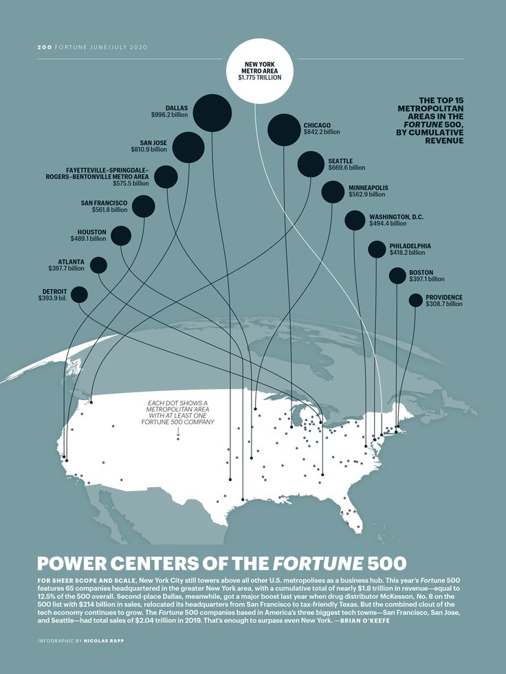

# 财富500强的经济中心

## 来源

用户提供的《Fortune》图版。

## 数据结构

每行一个都市区汇总，记录都市区、营收合计、排名。 这些字段用于分析和复现图形。

## 图形与阅读方式

圆与数值呈现前15名，引线把各都市区连回底图。图版量尺需凭原始图例核实。

用户提供的《Fortune》2020 年 6/7 月图版第 200 页，信息图署名 Nicolas Rapp。纽约标注 1.775 万亿美元，达拉斯标注 9962 亿美元。底图小点表示至少有一家榜单企业的都市区。按总部都市区汇总企业营收并排序，阅读时沿引线在数值与空间位置之间切换。

## 归类与案例特性

1. **01 数据逻辑**：[地理图形信息图形](../../01-%E4%BF%A1%E6%81%AF%E5%9B%BE%E5%BD%A2%E6%95%B0%E6%8D%AE%E9%80%BB%E8%BE%91/05-%E5%9C%B0%E7%90%86%E5%9B%BE%E5%BD%A2%E4%BF%A1%E6%81%AF%E5%9B%BE%E5%BD%A2%E6%A6%82%E5%BF%B5%E5%AE%9A%E4%B9%89.md)。都市区将榜单企业总部与美国底图关联，行政空间是汇总键。
2. **02 表现标签**：混合型信息图形。[查看同标签案例](./说明.md)。

## 视觉编码

底图点定位，引线匹配都市区与上方营收标注；白色突出纽约，圆的面积公式待核。

## 视觉叙事

先看纽约与达拉斯，再沿引线回到底图，底部文字说明排名背景。

## 制作方法与流程

统一总部都市区与美元单位 → 汇总企业营收并排序 → 标注前15名并核对引线起终点。

## 基础数据集

[下载 CSV（可用 Excel 打开）](./02-%E8%B4%A2%E5%AF%8C500%E5%BC%BA%E7%9A%84%E7%BB%8F%E6%B5%8E%E4%B8%AD%E5%BF%83-%E5%9F%BA%E7%A1%80%E6%95%B0%E6%8D%AE.csv)。表内记录可从图版辨读的数值、文字或对象。字段中若含角色或位置，即为图面观察。 空白表示图版未给出或当前无法核实。 榜单为 2020 年发布；末段三大科技都市区合计的报道口径为 2019 年销售额。营收统一换算为十亿美元。

| 对象 | 榜单年份 | 数据所属年 | 指标 | 排名 | 数值 | 单位 |
| --- | --- | --- | --- | --- | --- | --- |
| 纽约 | 2020 |  | 营收合计 | 1 | 1775 | 十亿美元 |
| 达拉斯 | 2020 |  | 营收合计 | 2 | 996.2 | 十亿美元 |
| 芝加哥 | 2020 |  | 营收合计 | 3 | 842.2 | 十亿美元 |
| 圣何塞 | 2020 |  | 营收合计 | 4 | 810.9 | 十亿美元 |
| 西雅图 | 2020 |  | 营收合计 | 5 | 669.6 | 十亿美元 |
| Fayetteville–Springdale–Rogers–Bentonville | 2020 |  | 营收合计 | 6 | 575.5 | 十亿美元 |
| 明尼阿波利斯 | 2020 |  | 营收合计 | 7 | 562.9 | 十亿美元 |
| 旧金山 | 2020 |  | 营收合计 | 8 | 561.8 | 十亿美元 |
| 华盛顿特区 | 2020 |  | 营收合计 | 9 | 494.4 | 十亿美元 |
| 休斯敦 | 2020 |  | 营收合计 | 10 | 489.1 | 十亿美元 |
| 费城 | 2020 |  | 营收合计 | 11 | 418.2 | 十亿美元 |
| 亚特兰大 | 2020 |  | 营收合计 | 12 | 397.7 | 十亿美元 |
| 波士顿 | 2020 |  | 营收合计 | 13 | 397.1 | 十亿美元 |
| 底特律 | 2020 |  | 营收合计 | 14 | 393.9 | 十亿美元 |
| 普罗维登斯 | 2020 |  | 营收合计 | 15 | 308.7 | 十亿美元 |
| 纽约 | 2020 |  | 上榜企业数 |  | 65 | 家 |
| 纽约 | 2020 |  | 占榜单总营收 |  | 12.5 | % |
| 麦凯森 | 2020 |  | 销售额 |  | 214 | 十亿美元 |
| 旧金山、圣何塞与西雅图 | 2020 | 2019 | 合计销售额 |  | 2040 | 十亿美元 |
