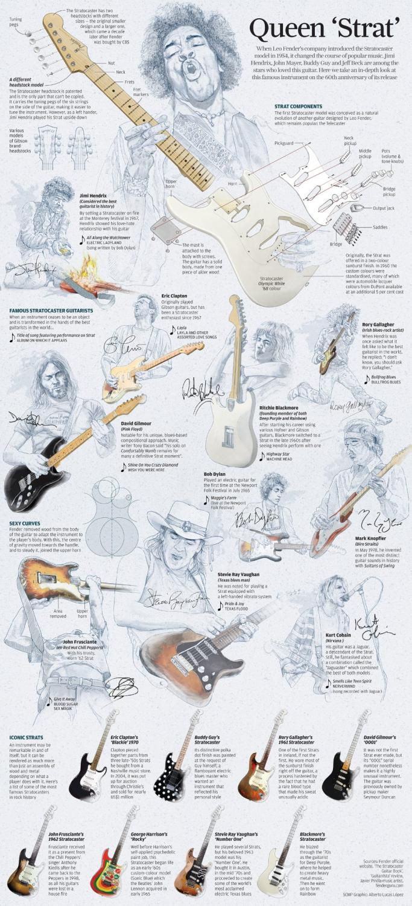

# Queen ‘Strat’

来源为用户提供的图版。主题是 Fender Stratocaster，页脚署名 Alberto Lucas López。

## 01 数据逻辑

[编目型信息图形](../../01-信息图形数据逻辑/03-编目型信息图形概念定义.md)。全页把部件、乐手、曲目和名琴组织成可独立查阅的条目。上部零件局部还有整体到部件的层级关系。

## 02 表现标签

[混合型信息图形](./说明.md)。全页结合爆炸图、琴体轮廓示意、人物插画、曲目注释与名琴图录。上部结构拆解也可参照 [Anatomical](../12-Anatomical/说明.md)。

## 数据结构

部件一行一个零件，名琴一行一把琴。乐手编号关联人物、曲目和名琴。曲目表空值表示图版未给出或当前未核实。图面年份含义见单独字段。Excel 导入时，将识别名称列设为文本，保留 0001 的前导零。

### 部件

[下载 CSV](./03-Queen-Strat-部件-基础数据.csv)

| 部件编号 | 部件名称 | 所属模块 | 位置 |
| --- | --- | --- | --- |
| C01 | 调音弦钮 | 琴颈组件 | 琴头 |
| C02 | 弦枕 | 琴颈组件 | 琴头与指板交界 |
| C03 | 品丝 | 琴颈组件 | 指板 |
| C04 | 品位标记 | 琴颈组件 | 指板 |
| C05 | 护板 | 琴体组件 | 琴体正面 |
| C06 | 琴颈拾音器 | 电路 | 靠琴颈 |
| C07 | 中间拾音器 | 电路 | 中间 |
| C08 | 琴桥拾音器 | 电路 | 靠琴桥 |
| C09 | 音量及音色电位器 | 电路 | 控制区 |
| C10 | 输出插孔 | 电路 | 琴体正面 |
| C11 | 弦鞍 | 琴桥组件 | 琴桥 |
| C12 | 琴桥 | 琴桥组件 | 琴体正面 |

### 乐手与曲目

[下载 CSV](./03-Queen-Strat-乐手与曲目-基础数据.csv)

| 乐手编号 | 乐手 | 曲目 | 专辑或版本 | 录音乐器备注 |
| --- | --- | --- | --- | --- |
| P01 | Jimi Hendrix | All Along the Watchtower | Electric Ladyland |  |
| P02 | Eric Clapton | Layla | Layla and Other Assorted Love Songs |  |
| P03 | David Gilmour | Shine On You Crazy Diamond | Wish You Were Here |  |
| P04 | Ritchie Blackmore | Highway Star | Machine Head |  |
| P05 | Stevie Ray Vaughan | Pride & Joy | Texas Flood |  |
| P06 | Kurt Cobain | Smells Like Teen Spirit | Nevermind | 图注注明以 Jaguar 录制 |
| P07 | Rory Gallagher | Bullfrog Blues | Bullfrog Blues |  |
| P08 | John Frusciante | Give It Away | Blood Sugar Sex Magik |  |
| P09 | Bob Dylan | Maggie’s Farm | 纽波特民谣音乐节现场 |  |
| P10 | Mark Knopfler | Sultans of Swing |  |  |
| P11 | Buddy Guy |  |  |  |
| P12 | George Harrison |  |  |  |

### 名琴

[下载 CSV](./03-Queen-Strat-名琴-基础数据.csv)

| 名琴编号 | 乐手编号 | 识别名称 | 图面年份 | 年份说明 |
| --- | --- | --- | --- | --- |
| G01 | P02 | Blackie | 1970 | 图面标题年份 |
| G02 | P11 | Buddy Guy 的 Stratocaster |  |  |
| G03 | P07 | Rory Gallagher 的 Stratocaster | 1961 | 图面标题所列琴款年份 |
| G04 | P03 | `0001` |  |  |
| G05 | P08 | John Frusciante 的 Stratocaster | 1962 | 图面标题所列琴款年份 |
| G06 | P12 | Rocky |  |  |
| G07 | P05 | Number One | 1963 | 正文所列琴款年份 |
| G08 | P04 | Blackmore 的 Stratocaster |  |  |

## 统计图形及应用

原图使用结构爆炸图、轮廓示意与图文目录。人物大小和琴身大小用于引导阅读。复现时可用年份点图呈现已核实且同口径的琴款年份，用关系图显示乐手与名琴之间的归属。

## 视觉编码

- 位置与大小。放大的 Hendrix 肖像和斜跨页面的琴颈提供入口，底部名琴按重复姿态排列。
- 线条。爆炸图的引线对应零件名称，琴体轮廓标出挖除区域与上角。
- 色彩与明度。低饱和人物素描衬托琴身颜色，便于辨认不同名琴。
- 符号与文字。音符标记曲目，粗体姓名定位人物，签名强化人物辨识。

## 信息框架

| 版面 | 信息 |
| --- | --- |
| 上部 | 型号背景、琴头与琴身组件 |
| 中部 | 乐手故事、代表曲目、琴体外形 |
| 底部 | 名琴外观、归属、年份与个案故事 |

## 叙事框架

先从 Hendrix 和放大的琴颈进入，再沿琴体看结构。中部按人物姓名与音符查找曲目。底部逐把浏览名琴，再回看对应乐手和故事。

## 制作方法与流程

整理部件、人物、曲目和名琴的关联 → 用放大的琴串联标题与结构标注 → 排布可独立阅读的人物小组 → 统一名琴图录的角度与图注 → 核对引线、录音乐器备注和年份口径。
