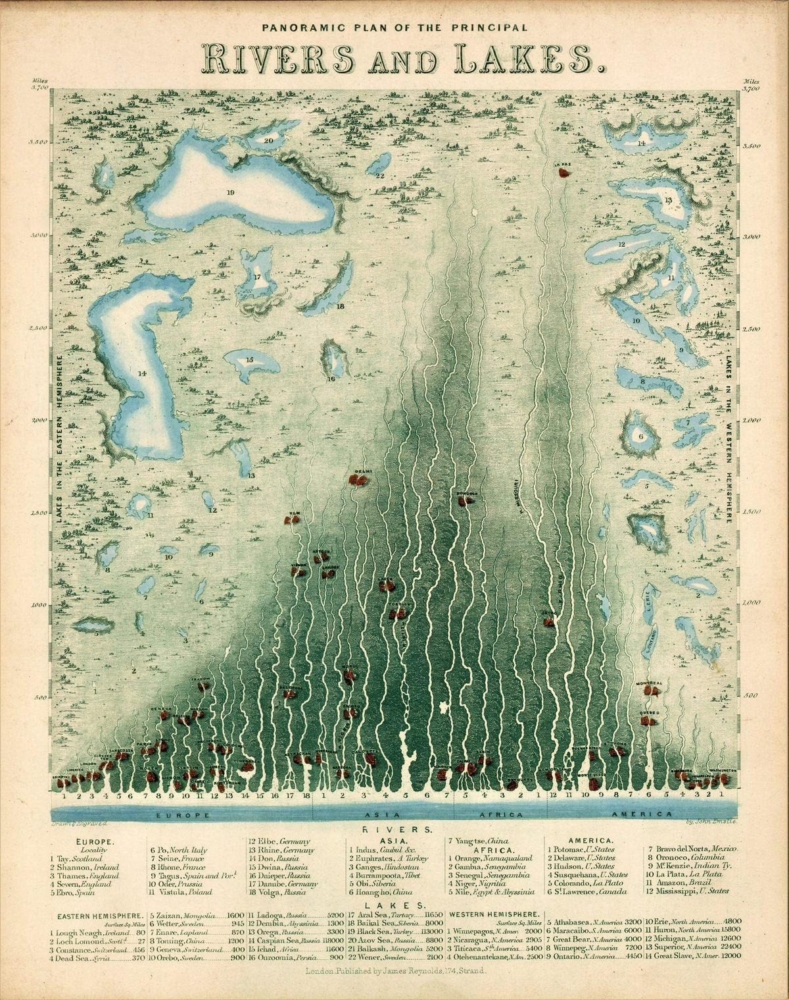

# 世界主要河流与湖泊比较图

用户提供的历史图版，原题为 *Panoramic Plan of the Principal Rivers and Lakes*，页脚标有伦敦出版者 James Reynolds。

## 01 数据逻辑

[编目型信息图形](../../01-信息图形数据逻辑/03-编目型信息图形概念定义.md)。河流按洲分组，湖泊按半球分组。分组与编号共同定位条目，目录将图形与名称对应。横向位置取决于分组与版面次序，相邻图形可以来自相隔很远的地区。

## 02 表现标签

[混合型信息图形](./说明.md)。共同基线的河长比较图、湖泊轮廓、城市标记与文字目录共同呈现。河长面板亦可关联[比较型信息图形](../06-比较型信息图形/说明.md)。

## 数据结构

河流、湖泊、沿河地标分别建表，每列一个字段。河流用洲别与编号联合识别，湖泊用半球与编号联合识别。下列为从图面辨读的样例，地区名称及湖泊面积保留历史图版口径。河长需由纵轴估读，建议补充读数方式和精度字段。

### 河流目录

[下载 CSV](./04-世界主要河流与湖泊比较图-河流目录-基础数据.csv)

| 洲别 | 图面编号 | 图面河名 | 图面地区 |
| --- | --- | --- | --- |
| 欧洲 | 3 | Thames | England |
| 欧洲 | 7 | Seine | France |
| 欧洲 | 17 | Danube | Germany |
| 欧洲 | 18 | Volga | Russia |
| 亚洲 | 3 | Ganges | Hindostan |
| 亚洲 | 7 | Yang tse | China |
| 非洲 | 5 | Nile | Egypt & Abyssinia |
| 美洲 | 11 | Amazon | Brazil |
| 美洲 | 12 | Mississippi | U. States |

### 湖泊面积

[下载 CSV](./04-世界主要河流与湖泊比较图-湖泊面积-基础数据.csv)

| 半球 | 图面编号 | 图面湖名 | 图面面积 | 单位 |
| --- | --- | --- | --- | --- |
| 东半球 | 1 | Lough Neagh | 80 | 平方英里 |
| 东半球 | 2 | Loch Lomond | 27 | 平方英里 |
| 东半球 | 11 | Ladoga | 5200 | 平方英里 |
| 东半球 | 18 | Baikal Sea | 8000 | 平方英里 |
| 西半球 | 9 | Ontario | 4450 | 平方英里 |
| 西半球 | 10 | Erie | 4800 | 平方英里 |
| 西半球 | 12 | Michigan | 12600 | 平方英里 |
| 西半球 | 13 | Superior | 22400 | 平方英里 |
| 西半球 | 14 | Great Slave | 12000 | 平方英里 |

### 沿河地标

[下载 CSV](./04-世界主要河流与湖泊比较图-沿河地标-基础数据.csv)

| 地标名称 | 类型 | 关联河流 | 图面位置 |
| --- | --- | --- | --- |
| London | 城市 | Thames | 欧洲河流区近底线 |
| Paris | 城市 | Seine | 欧洲河流区下部 |
| Cairo | 城市 | Nile | 非洲河流区下部 |
| Montreal | 城市 | St. Lawrence | 美洲河流区下部 |
| Quebec | 城市 | St. Lawrence | 美洲河流区下部 |

## 统计图形及应用

河道自共同底线向上延伸，以纵向范围对照两侧英里刻度来比较河长。两侧湖泊轮廓供辨认，面积以底部平方英里目录为准，统一轮廓比例尺待核实。沿河城市及分支补充水系关联。若需比较湖泊面积，可按原图数值另绘共尺度条形图。

## 视觉编码

- 垂直高度与刻度表达河长。
- 弯曲白线表现河道，分叉提示支流。
- 红褐色标记定位城市，与绿色背景形成对比。
- 蓝色轮廓描绘湖面，版面两侧分隔半球。
- 洲名、半球名与编号连接主图和文字目录。

## 信息框架与叙事框架

| 位置 | 信息 | 阅读路径 |
| --- | --- | --- |
| 中央 | 河长、洲别、城市、支流 | 先比较河道纵向范围，再跟随单条河流 |
| 两侧 | 东西半球湖形和编号 | 先辨认轮廓，再以编号查名称和面积 |
| 底部 | 名称、地区、面积目录 | 也可先找名称，再按分组与编号回到主图 |

例如，从西半球湖泊目录找到编号 13 的 Superior，再回到右侧定位同编号湖形。

## 制作方法与流程

整理三张基础表 → 绘制共同基线和英里刻度 → 按洲安放河道及支流城市 → 按半球布置湖形与编号 → 双向检查主图及目录索引。校对时分开处理英里与平方英里。
