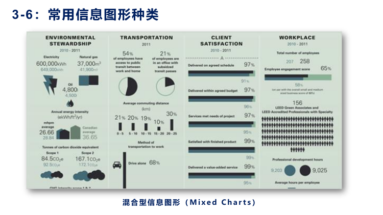
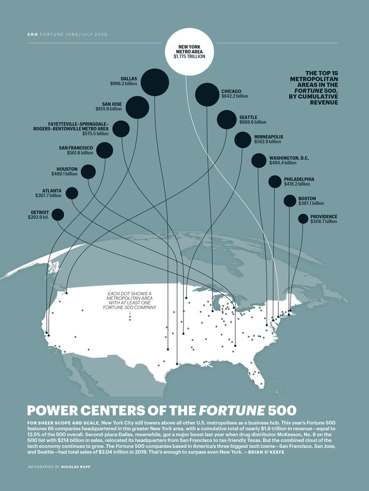

# 混合型信息图形（Mixed Charts）

混合型信息图形把统计图形、数字标签、图形符号与叙事版式组合起来。图标可使用能核实来源的 ISO 图形符号，需记录标准或编号。一般象形图可依图例命名。每个组件都应服务于明确的读者问题，并保留自己的口径和单位。

## 案例 01：分栏指标信息图

来源为课件第 22 页。画面按环境、交通、客户满意度和工作场所分栏。圆形扇区显示比例，水平条表现单项百分比，重复人形和交通象形图辅助识别数量与主题。人形的换算和标准编号需依据原图图例核实。叙事可按分栏阅读，每组先看栏目标题，再读数值和图示。复用时统一百分比条的基准，为图标阵列注明每个符号的代表数量，并让数字紧贴解释对象。

## 案例 02：《财富》500 强的经济中心

来源为用户提供的《Fortune》2020 年 6/7 月图版，第 200 页。信息图署名 Nicolas Rapp。图版以美国都市区为汇总单位，上半部标出 15 个营收领先都市区，纽约以白色大圆突出并标注 1.775 万亿美元，达拉斯标注 9962 亿美元。下部底图的小点表示至少有一家榜单企业的都市区。弯曲引线连接上方量值标注与底图位置，引线在这里承担定位功能。

将企业按总部都市区分组、求营收合计，以统一单位排序。圆和数字并置支持总体比较与精确读数，地图回答分布问题，底部报道补充背景。应检查引线交叉是否干扰追踪，并保留“前 15 名”的选择规则与圆的量尺说明。

## 增补原则

新增案例时，逐项写明统计组件、象形符号的语义、版式阅读顺序和计算依据。由案例证据修订对应的概念定义。
