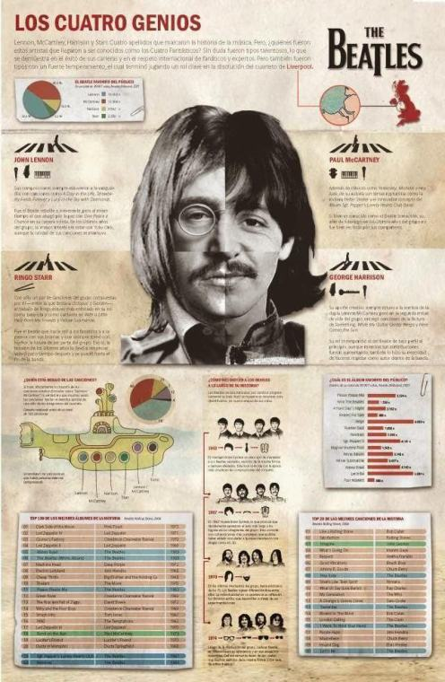

# 披头士人物与作品

## 来源

《第三讲-信息图形类型学》PDF 第 23 页，按课件标注归类。图片保留案例图版区域。

## 数据结构

可按人物、作品或指标建表，保留条目类型和资料出处。 这些字段用于分析和复现图形。

## 图形与阅读方式

肖像提供阅读入口，外围小图与底部栅格支持分块浏览。

画面照片和短注服务于识别与检索。课件截图中的细字和统计单位需凭原图核实。

## 归类与案例特性

1. **01 数据逻辑**：[编目型信息图形](../../01-%E4%BF%A1%E6%81%AF%E5%9B%BE%E5%BD%A2%E6%95%B0%E6%8D%AE%E9%80%BB%E8%BE%91/03-%E7%BC%96%E7%9B%AE%E5%9E%8B%E4%BF%A1%E6%81%AF%E5%9B%BE%E5%BD%A2%E6%A6%82%E5%BF%B5%E5%AE%9A%E4%B9%89.md)。人物和作品是可独立查找的主题条目。
2. **02 表现标签**：文字型与列表型信息图形。[查看同标签案例](./说明.md)。

## 视觉编码

中心肖像是主入口，小图和微型图表承载次级信息，底部栅格承载密集记录。

## 视觉叙事

先识别乐队主题，再看成员模块，最后浏览作品细目。

## 制作方法与流程

建立人物表和作品表 → 用人物编号关联 → 按主题排版并校对原文字。

## 基础数据集

[下载 CSV（可用 Excel 打开）](./01-%E6%8A%AB%E5%A4%B4%E5%A3%AB%E4%BA%BA%E7%89%A9%E4%B8%8E%E4%BD%9C%E5%93%81-%E5%9F%BA%E7%A1%80%E6%95%B0%E6%8D%AE.csv)。表内记录可从图版辨读的数值、文字或对象。字段中若含角色或位置，即为图面观察。 空白表示图版未给出或当前无法核实。

| 条目 | 类别 |
| --- | --- |
| The Beatles | 乐队 |
| John Lennon | 成员 |
| Paul McCartney | 成员 |
| George Harrison | 成员 |
| Ringo Starr | 成员 |
