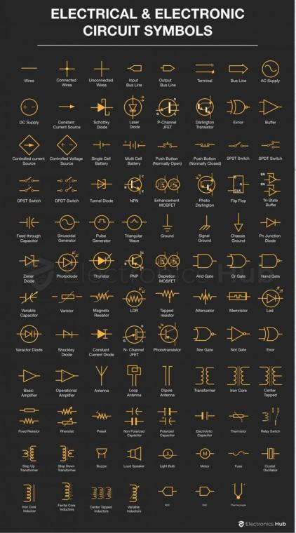

# 电路符号表

## 来源

《第三讲-信息图形类型学》PDF 第 14 页，作为相关表现方式的补充案例。图片保留案例图版区域。

## 数据结构

每行一个符号，记录类别、名称和含义。 这些字段用于分析和复现图形。

## 图形与阅读方式

分组网格便于逐项查找。严格 A–Z 排序仍需专门图例支持。

## 归类与案例特性

1. **01 数据逻辑**：[编目型信息图形](../../01-%E4%BF%A1%E6%81%AF%E5%9B%BE%E5%BD%A2%E6%95%B0%E6%8D%AE%E9%80%BB%E8%BE%91/03-%E7%BC%96%E7%9B%AE%E5%9E%8B%E4%BF%A1%E6%81%AF%E5%9B%BE%E5%BD%A2%E6%A6%82%E5%BF%B5%E5%AE%9A%E4%B9%89.md)。符号按电路含义分组并逐项查找，画面依据类别网格组织。
2. **02 表现标签**：文字型与列表型信息图形。[查看同标签案例](./说明.md)。

## 视觉编码

线形、连接点和元件轮廓表达电气语义，小字标识名称。

## 视觉叙事

先看电路符号主题，再按网格定位，最后核对符形和名称。

## 制作方法与流程

逐项录入符号名称 → 建定宽网格 → 绘制标准形态并检查是否与名称一致。

## 基础数据集

[下载 CSV（可用 Excel 打开）](./03-%E7%94%B5%E8%B7%AF%E7%AC%A6%E5%8F%B7%E8%A1%A8-%E5%9F%BA%E7%A1%80%E6%95%B0%E6%8D%AE.csv)。表内记录可从图版辨读的数值、文字或对象。字段中若含角色或位置，即为图面观察。 空白表示图版未给出或当前无法核实。 现有图版的索引按类别与格位组织，因此主类判为编目型。具有明确 A–Z 排列的符号表可另归字母表型。

| 符号名称 | 观察对象 |
| --- | --- |
| Connected Wires | 导线连接 |
| Unconnected Wires | 导线未连接 |
| Bus Line | 总线 |
| Battery | 电池 |
| Push Button | 按钮 |
| SPST Switch | 单刀单掷开关 |
