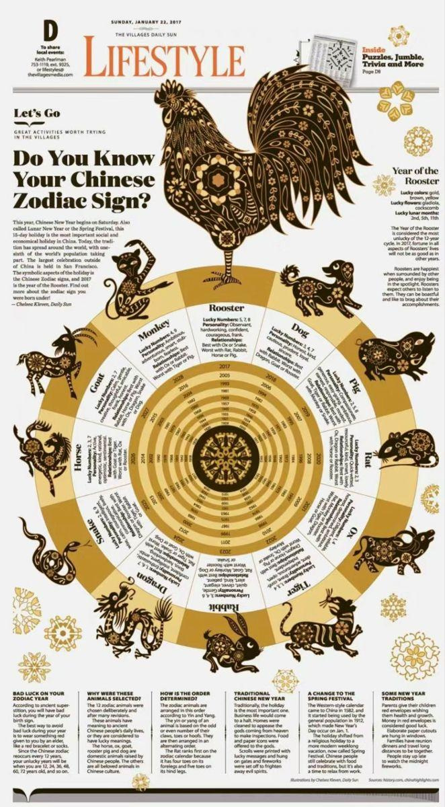

# 你知道自己的中国生肖吗？

来源为用户提供的《The Villages Daily Sun》Lifestyle 版图像，图面日期为 2017 年 1 月 22 日，标题为 *Do You Know Your Chinese Zodiac Sign?*。

## 01 数据逻辑

[编目型信息图形](../../01-信息图形数据逻辑/03-编目型信息图形概念定义.md)。十二生肖各占一个可独立检索的条目。十二年循环用于在年份和生肖之间建立索引。

## 02 表现标签

[文字型与列表型信息图形](./说明.md)。十二个图文条目呈环形排列。可以从年份向外查生肖，也可以从动物向内查同一生肖的其他年份。

## 数据结构

按生肖编号关联目录、年份和属性。每列一个字段。年份表记录图面标签，按生日精确查询还需要该年生肖起止日期。属性表按原图记录民俗说法。本次年份及属性表收录上一轮分析中辨读的样例。

### 生肖目录

[下载 CSV](./04-中国十二生肖年份圆盘-生肖目录-基础数据.csv)

| 生肖编号 | 中文名 | 原图英文名 | 顺时针序号 |
| --- | --- | --- | --- |
| Z01 | 鸡 | Rooster | 1 |
| Z02 | 狗 | Dog | 2 |
| Z03 | 猪 | Pig | 3 |
| Z04 | 鼠 | Rat | 4 |
| Z05 | 牛 | Ox | 5 |
| Z06 | 虎 | Tiger | 6 |
| Z07 | 兔 | Rabbit | 7 |
| Z08 | 龙 | Dragon | 8 |
| Z09 | 蛇 | Snake | 9 |
| Z10 | 马 | Horse | 10 |
| Z11 | 羊 | Goat | 11 |
| Z12 | 猴 | Monkey | 12 |

### 年份索引

[下载 CSV](./04-中国十二生肖年份圆盘-年份索引-基础数据.csv)

| 图面年份 | 生肖编号 |
| --- | --- |
| 1993 | Z01 |
| 2005 | Z01 |
| 2017 | Z01 |
| 2018 | Z02 |
| 2019 | Z03 |
| 2020 | Z04 |
| 2021 | Z05 |
| 2022 | Z06 |
| 2023 | Z07 |

### 生肖属性

[下载 CSV](./04-中国十二生肖年份圆盘-生肖属性-基础数据.csv)

| 生肖编号 | 属性类型 | 属性值 |
| --- | --- | --- |
| Z01 | 幸运数字 | 5 |
| Z01 | 幸运数字 | 7 |
| Z01 | 幸运数字 | 8 |
| Z01 | 性格描述 | Observant |
| Z01 | 性格描述 | Hardworking |
| Z01 | 性格描述 | Confident |

## 统计图形及应用

十二个等宽扇区提供类别位置。同心年份环用于追踪同一生肖相隔十二年的年份。角度和面积没有人口占比等量值含义。圆盘可用于生肖查找，亦可用相同布局展示其他固定周期的分类目录。

## 视觉编码

- 角度定位生肖，同一半径对齐图标、名称、属性和年份。
- 交替的金色色带分隔年份圈，动物轮廓提供快速识别入口。
- 放大的深色公鸡突出鸡年主题。粗体名称与较小的属性文字形成阅读层级。
- 标签随扇区转动，底部文字需要转动页面来读。

## 信息框架与叙事框架

| 版面 | 信息内容 | 阅读路径 |
| --- | --- | --- |
| 上部 | 提问式标题、公鸡插图和鸡年专栏 | 从自己的生肖问题进入，再读当年背景 |
| 圆盘外圈 | 图标、名称及属性 | 从认识的动物进入对应扇区 |
| 圆盘内圈 | 多圈年份 | 先找出生年份，再沿半径向外读生肖 |
| 底部 | 排序缘由和春节习俗 | 完成查找后继续读文化背景 |

## 制作方法与流程

建立生肖编号、年份和属性表 → 等分十二个 30° 扇区 → 依图顺时针排列 → 对齐同生肖的图标和各圈年份 → 补主标题和民俗专栏 → 以 2017 找鸡，再从鸡查 2005 和 1993，复核双向索引。
