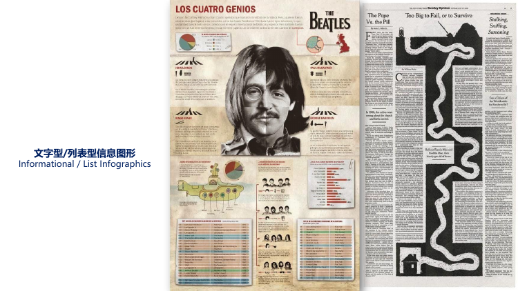

# 文字型与列表型信息图形（Informational / List Infographics）

以文字条目承担信息，借标题、序号、图标、留白和分栏帮助检索。条目可按主题、优先级或次序组织。存在数量时，可辅以表格、柱形或比例标记，给出单项与总体的口径。

## 案例：披头士与同页长文图版

来源为课件第 23 页。左图以肖像为阅读焦点，周围安排小图和短注，底部用多列信息密集的带状区块支持对照。右图以大块文字和白色蜿蜒图形组织版面，读者先识别段落层次，再沿路径看局部内容。课件缩图支持版式分析，细字和统计单位待原图核实。

信息架构可记录主题编号、条目标题、正文、指标值、单位、来源和排版顺序。复用左图的做法时，可先建立清晰入口，再让同类条目共享固定网格和字段顺序。复用右图的阅读路径时，可用编号或小标题帮助读者从图形返回对应文字。

新增案例时，记录读者可以逐条查找的内容、条目顺序与文字和图形的对应关系。优先保留首屏可读的标题和关键数字。
