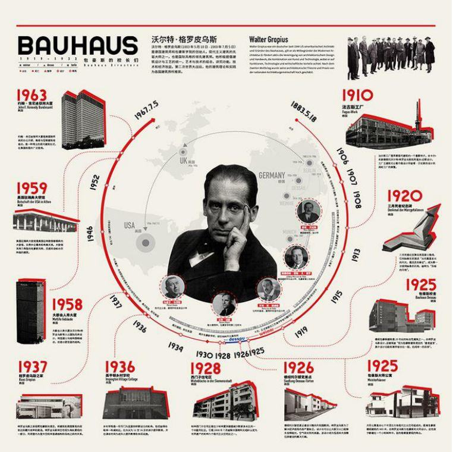

# 包豪斯环形时间轴

## 来源

《第三讲-信息图形类型学》PDF 第 24 页，按课件标注归类。图片保留案例图版区域。

## 数据结构

每行一个事件，记录年份、事件、关联建筑和来源。 这些字段用于分析和复现图形。

## 图形与阅读方式

中心人物定位主题，外围年份和建筑按环形路径排列。角度与时间间隔的对应关系待核实。

红色年份标签、建筑小图与说明邻近对应节点。复用时明确起点、推进方向及年份和事件的配对。
