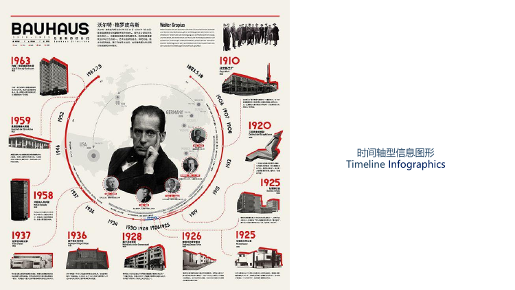
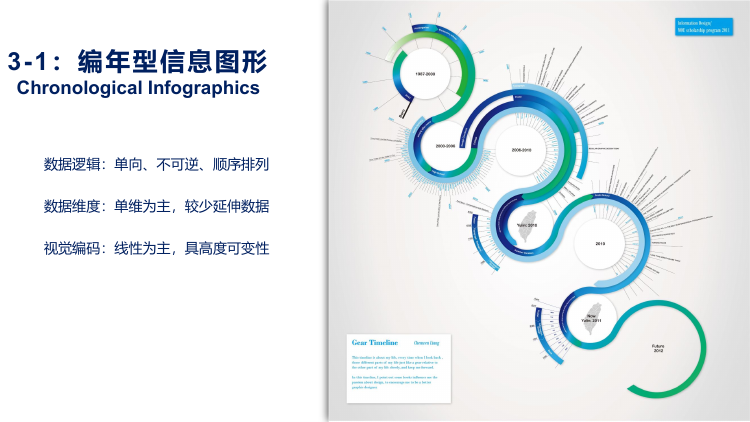

# 时间轴型信息图形（Timeline Infographics）

以时间轴、顺序轨或环形路径串起时间点与区间。日期字段决定事件的排序，间距的含义需由刻度或说明确定。表格可记录事件编号、起止时间、时间精度、名称、图注与来源。

## 案例 01：包豪斯环形时间轴

来源为课件第 24 页。中心肖像提供主题入口，红色年份沿环形布置，建筑小图和说明邻近相应节点。年份标签与节点连读，可定位各事件。课件截图可用于分析层级与空间安排，无法由图确认等角间隔对应的时间长度。复用时标明起点、推进方向、年份和事件的对应关系。

## 案例 02：弯曲路径上的编年事件

来源为课件第 3 页。连续弧段把时间顺序压入单页，小分支承接局部标签，色带区分相邻段落。主轴在弯曲处仍需可辨识，可用箭头或年代锚点帮助读者跨段。若要比较间隔或持续时间，应使用有刻度且定义明确的时间比例。

新增案例时记录点事件与持续区间、时间分辨率、时间方向、刻度以及转折标记，并回填编年型的定义与原则。
