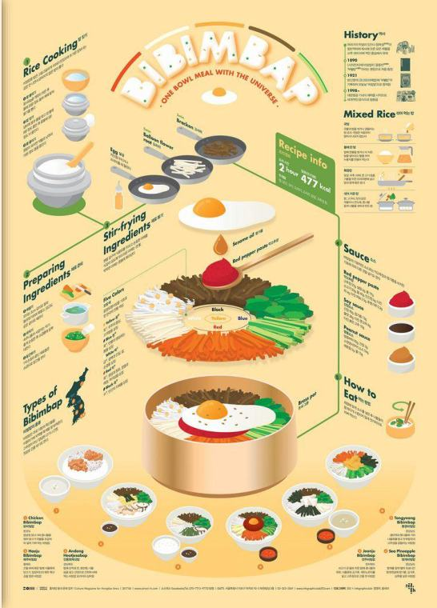

# 食材与成品示意

## 来源

《第三讲-信息图形类型学》PDF 第 25 页，按课件标注归类。图片保留案例图版区域。

## 数据结构

每行一种食材或一个步骤，记录名称、次序和对应图标。 这些字段用于分析和复现图形。

## 图形与阅读方式

锅具、食材和成品形成操作线索，分散的标签提供局部解释。

## 归类与案例特性

1. **01 数据逻辑**：[编目型信息图形](../../01-%E4%BF%A1%E6%81%AF%E5%9B%BE%E5%BD%A2%E6%95%B0%E6%8D%AE%E9%80%BB%E8%BE%91/03-%E7%BC%96%E7%9B%AE%E5%9E%8B%E4%BF%A1%E6%81%AF%E5%9B%BE%E5%BD%A2%E6%A6%82%E5%BF%B5%E5%AE%9A%E4%B9%89.md)。拌饭图按食材、过程和成品等模块组织。
2. **02 表现标签**：示意图型。[查看同标签案例](./说明.md)。

## 视觉编码

中央分层食物建立部件关系，周围小碟与说明形成配料索引。

## 视觉叙事

先认出 Bibimbap，再看中央组合，最后查小标签和侧栏。

## 制作方法与流程

将原料与容器图例分表 → 绘制中央拆解 → 在外围建立对应标注。

## 基础数据集

[下载 CSV（可用 Excel 打开）](./02-%E9%A3%9F%E6%9D%90%E4%B8%8E%E6%88%90%E5%93%81%E7%A4%BA%E6%84%8F-%E5%9F%BA%E7%A1%80%E6%95%B0%E6%8D%AE.csv)。表内记录可辨读的标签和图面结构。角色、位置与关系说明依据图面观察。 空白表示图版未给出或当前无法核实。

| 图中对象 | 版面角色 |
| --- | --- |
| Bibimbap | 标题 |
| 鸡蛋图示 | 中心配料 |
| 分置小碟 | 外围配料示意 |
| 拌饭碗 | 成品示意 |
