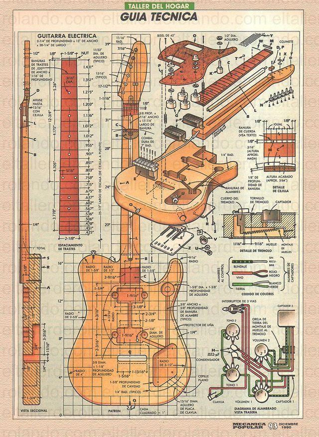

# 电吉他制作技术图解

来源为用户提供的 *Mecánica Popular* 图版，1990 年 12 月，第 93 页，标题 *Guitarra Eléctrica*。

## 01 数据逻辑

[层级型信息图形](../../01-信息图形数据逻辑/02-层级型信息图形概念定义.md)。由整机、琴体、琴颈、琴桥与电路等模块向下展开到零件、孔位和端子。接线用额外的连接关系描述跨部件关联。

## 02 表现标签

[示意图型](./说明.md)。爆炸图、尺寸模板、局部剖面与接线图配合说明加工、装配和接线。

## 图形特性与信息框架

| 位置 | 内容 | 用途 |
| --- | --- | --- |
| 左侧 | 琴颈侧剖与指板 | 放样，读取品丝位置 |
| 中央及右上 | 整机与爆炸图 | 对照零件、连接件和装配位置 |
| 右侧中部 | 品丝与琴桥机构详图 | 核对槽、螺钉、弹簧的配合 |
| 下方中央 | 琴体方格模板 | 定位轮廓、腔体和孔位 |
| 右下 | 导线图例与接线 | 按线色跟踪连接 |

## 数据结构

零件表用零件编号连接尺寸表与端子表。尺寸按对象、尺寸名称、数值、单位记录。完整接线采用起点元件、起点端子、终点元件、终点端子和线色五列。细小端子和尺寸留待高清图核对。

[下载基础数据 CSV](./03-电吉他制作技术图解-基础数据.csv)。每列一个字段。空白表示该条目没有独立的可录数值。

| 表项 | 对象 | 所属模块 | 参数 | 数值 | 单位 | 图面位置 |
| --- | --- | --- | --- | --- | --- | --- |
| 零件 | 琴体木坯 | 琴体 |  |  |  | 琴体模板 |
| 零件 | 指板 | 琴颈 |  |  |  | 指板尺寸图 |
| 零件 | 颤音机构弹簧 | 琴桥 |  |  |  | 局部剖面 |
| 零件 | 拾音器 1 | 电路 |  |  |  | 接线图 |
| 零件 | 拾音器 2 | 电路 |  |  |  | 接线图 |
| 零件 | 三档开关 | 电路 |  |  |  | 接线图 |
| 尺寸 | 吉他 | 整机 | 总长 | 39 | 英寸 | 左上尺寸图 |
| 尺寸 | 琴体模板方格 | 琴体 | 单格边长 | 1 | 英寸 | 琴体模板 |
| 尺寸 | 弦枕至琴桥 | 整机 | 弦长 | 25.5 | 英寸 | 琴颈与琴桥侧图 |
| 参数 | 切换开关 | 电路 | 档位数 | 3 | 档 | 接线图 |
| 参数 | 电容 | 电路 | 电容量 | 0.022 | µF | 接线图 |

## 统计图形及应用

原图使用工程尺寸图、爆炸视图、局部剖面及电路图。学习复现时，可将品序与距弦枕的累计距离绘成点图。若需比较相邻品距，先统一测量起点，再将相邻累计距离相减并绘制柱形图。

## 视觉编码

位置与间距表达装配方向。轮廓线描形，尺寸线标尺度，引线关联注释，导线表示电气连接。孔位及端点用点状标记定位。剖面排线表现切开的材料，暖色色面辨识木质主体。电路色配图例，字母和数字可用于跨视图查找。

## 叙事框架

初读先从整机与爆炸图识别模块，再向四周查尺寸、剖面与线色。制作时，从琴颈和琴体模板取数，回到爆炸图核对装配，最后检查琴桥机构与电路端子。

## 制作方法与流程

拆解零件和连接关系 → 绘制有统一单位的尺寸图与模板 → 按装配轴绘制爆炸图 → 补齐局部剖面和接线 → 跨视图复核编号、方向、尺寸和位置。
