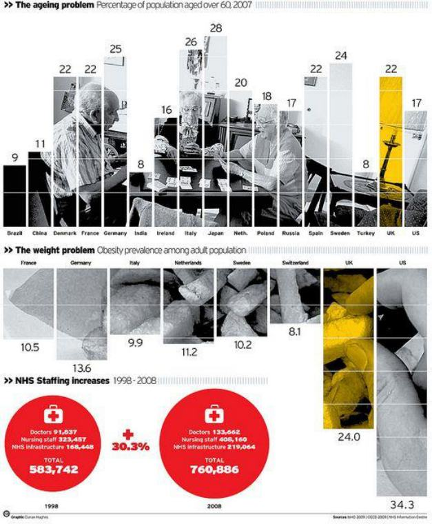

# 照片与量值对照

## 来源

《第三讲-信息图形类型学》PDF 第 29 页，按课件标注归类。图片保留案例图版区域。

## 数据结构

每行一个对象或分组，记录测量值和照片出处。 这些字段用于分析和复现图形。

## 图形与阅读方式

照片与竖向图形并置，位置和长度承担量值比较。

## 归类与案例特性

1. **01 数据逻辑**：[编目型信息图形](../../01-%E4%BF%A1%E6%81%AF%E5%9B%BE%E5%BD%A2%E6%95%B0%E6%8D%AE%E9%80%BB%E8%BE%91/03-%E7%BC%96%E7%9B%AE%E5%9E%8B%E4%BF%A1%E6%81%AF%E5%9B%BE%E5%BD%A2%E6%A6%82%E5%BF%B5%E5%AE%9A%E4%B9%89.md)。三个主题面板分别按国家或年份组织，不能把不同指标共用同一尺度。
2. **02 表现标签**：图片式信息图形。[查看同标签案例](./说明.md)。

## 视觉编码

照片裁入条形，条长承载比率，黄色突出英国；红圆配数字呈 NHS 人数对照。

## 视觉叙事

由老龄化到肥胖，再到 NHS 人员变化。

## 制作方法与流程

把国家指标与人员指标分表 → 按面板建量尺 → 蒙版填充照片并校对数字。

## 基础数据集

[下载 CSV（可用 Excel 打开）](./01-%E7%85%A7%E7%89%87%E4%B8%8E%E9%87%8F%E5%80%BC%E5%AF%B9%E7%85%A7-%E5%9F%BA%E7%A1%80%E6%95%B0%E6%8D%AE.csv)。表内记录可从图版辨读的数值、文字或对象。字段中若含角色或位置，即为图面观察。 空白表示图版未给出或当前无法核实。

| 指标 | 国家或机构 | 年份 | 数值 | 单位 |
| --- | --- | --- | --- | --- |
| 60岁以上人口占比 | Brazil | 2007 | 9 | % |
| 60岁以上人口占比 | China | 2007 | 11 | % |
| 60岁以上人口占比 | Denmark | 2007 | 22 | % |
| 60岁以上人口占比 | France | 2007 | 22 | % |
| 60岁以上人口占比 | Germany | 2007 | 25 | % |
| 60岁以上人口占比 | India | 2007 | 8 | % |
| 60岁以上人口占比 | Ireland | 2007 | 16 | % |
| 60岁以上人口占比 | Italy | 2007 | 26 | % |
| 60岁以上人口占比 | Japan | 2007 | 28 | % |
| 60岁以上人口占比 | Netherlands | 2007 | 20 | % |
| 60岁以上人口占比 | Poland | 2007 | 18 | % |
| 60岁以上人口占比 | Russia | 2007 | 17 | % |
| 60岁以上人口占比 | Spain | 2007 | 22 | % |
| 60岁以上人口占比 | Sweden | 2007 | 24 | % |
| 60岁以上人口占比 | Turkey | 2007 | 8 | % |
| 60岁以上人口占比 | UK | 2007 | 22 | % |
| 60岁以上人口占比 | US | 2007 | 17 | % |
| 成人肥胖率 | France |  | 10.5 | % |
| 成人肥胖率 | Germany |  | 13.6 | % |
| 成人肥胖率 | Italy |  | 9.9 | % |
| 成人肥胖率 | Netherlands |  | 11.2 | % |
| 成人肥胖率 | Sweden |  | 10.2 | % |
| 成人肥胖率 | Switzerland |  | 8.1 | % |
| 成人肥胖率 | UK |  | 24.0 | % |
| 成人肥胖率 | US |  | 34.3 | % |
| 人员总数 | NHS | 1998 | 583742 | 人 |
| 人员总数 | NHS | 2008 | 760886 | 人 |
| 人员增幅 | NHS |  | 30.3 | % |
| 医生 | NHS | 1998 | 91837 | 人 |
| 护理人员 | NHS | 1998 | 323457 | 人 |
| 基础设施人员 | NHS | 1998 | 168448 | 人 |
| 医生 | NHS | 2008 | 133662 | 人 |
| 护理人员 | NHS | 2008 | 408160 | 人 |
| 基础设施人员 | NHS | 2008 | 219064 | 人 |
