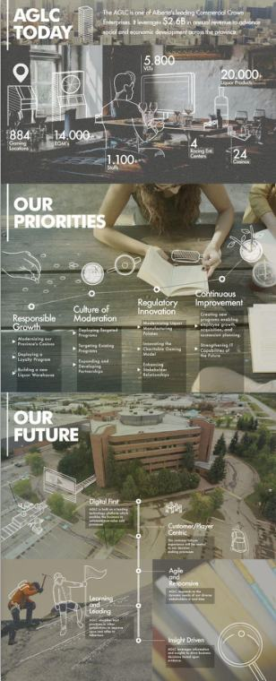

# 地面场景照片图版

## 来源

《第三讲-信息图形类型学》PDF 第 29 页，按课件标注归类。图片保留案例图版区域。

## 数据结构

每行一张照片，记录对象、地点、时间和配文。 这些字段用于分析和复现图形。

## 图形与阅读方式

照片提供识别线索，叠加的文字逐块解释画面。

## 归类与案例特性

1. **01 数据逻辑**：[编目型信息图形](../../01-%E4%BF%A1%E6%81%AF%E5%9B%BE%E5%BD%A2%E6%95%B0%E6%8D%AE%E9%80%BB%E8%BE%91/03-%E7%BC%96%E7%9B%AE%E5%9E%8B%E4%BF%A1%E6%81%AF%E5%9B%BE%E5%BD%A2%E6%A6%82%E5%BF%B5%E5%AE%9A%E4%B9%89.md)。照片背景上的文本按现状、优先事项、未来三个栏目组织。
2. **02 表现标签**：图片式信息图形。[查看同标签案例](./说明.md)。

## 视觉编码

大字标题、遮罩及图标区分照片段与注释栏。

## 视觉叙事

从 Today 看现状，再看 Priorities，最后 Future。

## 制作方法与流程

给照片配主题和来源 → 按三段排序 → 调遮罩对比度并核对注释位置。

## 基础数据集

[下载 CSV（可用 Excel 打开）](./02-%E5%9C%B0%E9%9D%A2%E5%9C%BA%E6%99%AF%E7%85%A7%E7%89%87%E5%9B%BE%E7%89%88-%E5%9F%BA%E7%A1%80%E6%95%B0%E6%8D%AE.csv)。表内记录可从图版辨读的数值、文字或对象。字段中若含角色或位置，即为图面观察。 空白表示图版未给出或当前无法核实。

| 板块 | 顺序 |
| --- | --- |
| AGLC Today | 1 |
| Our Priorities | 2 |
| Our Future | 3 |
