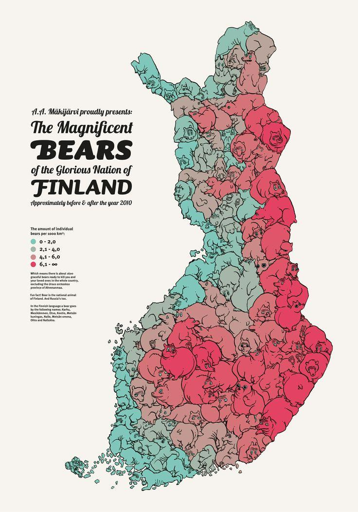

# 芬兰熊分布图

## 来源

《第三讲-信息图形类型学》PDF 第 30 页，按课件标注归类。图片保留案例图版区域。

## 数据结构

可按地区和下级地理单元组织记录，保留地区标识与指标。 这些字段用于分析和复现图形。

## 图形与阅读方式

区域边界与颜色形成空间分组，颜色对应的具体口径需查原图图例。

## 归类与案例特性

1. **01 数据逻辑**：[地理图形信息图形](../../01-%E4%BF%A1%E6%81%AF%E5%9B%BE%E5%BD%A2%E6%95%B0%E6%8D%AE%E9%80%BB%E8%BE%91/05-%E5%9C%B0%E7%90%86%E5%9B%BE%E5%BD%A2%E4%BF%A1%E6%81%AF%E5%9B%BE%E5%BD%A2%E6%A6%82%E5%BF%B5%E5%AE%9A%E4%B9%89.md)。数据落在芬兰地理分区上，虽在课件层级标签中，主要阅读键是地区。
2. **02 表现标签**：层级型信息图形。[查看同标签案例](./说明.md)。

## 视觉编码

分区边界给定位，红绿分级对应熊密度，原阈值及分母完整单位需核。

## 视觉叙事

先看全国格局再查区域颜色与图例。

## 制作方法与流程

连接地区指标与边界 → 核实统计分母和分级阈值 → 绘制分级设色。

## 基础数据集

[下载 CSV（可用 Excel 打开）](./01-%E8%8A%AC%E5%85%B0%E7%86%8A%E5%88%86%E5%B8%83%E5%9B%BE-%E5%9F%BA%E7%A1%80%E6%95%B0%E6%8D%AE.csv)。表内记录可辨读的标签和图面结构。角色、位置与关系说明依据图面观察。 空白表示图版未给出或当前无法核实。 课件的层级型是表现标签。本图按地图位置读取数值，因此数据逻辑归地理图形。

| 原图要素 | 观察值 |
| --- | --- |
| 范围 | Finland |
| 主题 | Bears |
| 时间说明 | Approximately before & after the year 2010 |
| 色阶 | 青至红 |

## 独立图版与详细分析

原题为 *The Magnificent Bears of the Glorious Nation of Finland*。图面署名 A. A. Mäkijärvi，时间标注为约 2010 年前后。

**01 数据逻辑**为地理图形，熊密度依附于芬兰境内的位置。**02 表现标签**沿用课件的层级型，读者从全国轮廓读到局部色块，再查四级密度图例。具体统计图形为分级设色专题地图。

### 补充基础数据

每列一个字段。第四级在图面标为 6.1–∞，上限留空。密度区间按原图的一位小数转录。区域观察描述的是版面概况。原统计分区边界、区域面积和个体数需要原始数据核实。

#### 密度分级

[下载 CSV](./01-芬兰熊分布图-密度分级-基础数据.csv)

| 等级 | 下限 | 上限 | 单位 | 图面颜色 |
| --- | --- | --- | --- | --- |
| 1 | 0.0 | 2.0 | 只／1000平方公里 | 青绿色 |
| 2 | 2.1 | 4.0 | 只／1000平方公里 | 灰绿色 |
| 3 | 4.1 | 6.0 | 只／1000平方公里 | 浅粉红 |
| 4 | 6.1 |  | 只／1000平方公里 | 深粉红 |

#### 区域观察

[下载 CSV](./01-芬兰熊分布图-区域观察-基础数据.csv)

| 区域方位 | 主要色级下限 | 主要色级上限 | 图面观察 |
| --- | --- | --- | --- |
| 西南沿海 | 1 | 1 | 青绿色较集中 |
| 东部边缘 | 4 | 4 | 多处深粉红色块 |
| 南部内陆 | 3 | 4 | 浅粉红和深粉红较多 |
| 北部 |  |  | 青绿、灰绿和粉红交错 |

如获得原始记录，可按区域编号、区域名称、时期、面积、熊个体数、密度、密度等级逐列建表。同口径的密度等于熊个体数除以区域面积（平方公里），再乘以 1000。

### 统计图形及应用

颜色对应密度档位，用于比较东部边缘、西南沿海及其他区域的相对密度。相同颜色表示落在同一档。熊图标的数量、大小和姿态承担插画表现，图例只给颜色定义了密度区间。

### 视觉编码

芬兰国土轮廓负责定位，青绿至深粉红的四色区分档位。黑色轮廓勾出熊的姿态，让插图连成一张地图。左侧留白安放大标题、时间、图例和背景文字。

### 信息框架与叙事框架

先通过标题和熊拼成的轮廓识别主题，再查左侧图例了解单位和四个档位。接着对照东部边缘与西南沿海，在读出空间差异后补看时期和背景说明。

### 制作流程

按区域整理数据和面积 → 建立四档色阶 → 绘制区域底图 → 沿地图轮廓组织熊插画 → 添加图例 → 任选高低色区，核对颜色和区间是否与底图一致。
