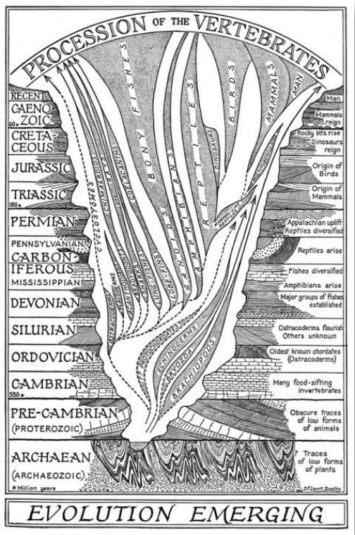

# 脊椎动物演化

## 来源

《第三讲-信息图形类型学》PDF 第 6 页，作为相关表现方式的补充案例。图片保留案例图版区域。

## 数据结构

节点表记录类群与年代，关系表记录分支连接。 这些字段用于分析和复现图形。

## 图形与阅读方式

树状主干和分支表达谱系，地层标签交代时间背景。

课件注明图版出自 William King Gregory《进化论的出现》卷首插画。分支宽度的具体统计含义待原始图例核实。
