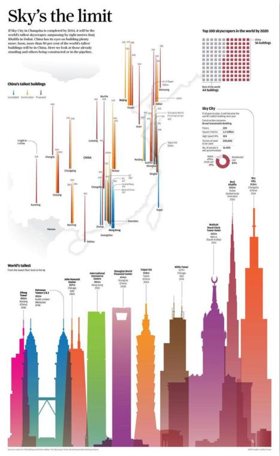

# 建筑高度比较

## 来源

《第三讲-信息图形类型学》PDF 第 31 页，按课件标注归类。图片保留案例图版区域。

## 数据结构

每行一座建筑，记录建筑名、高度和单位。 这些字段用于分析和复现图形。

## 图形与阅读方式

各建筑共享高度方向，轮廓辅助辨识，纵向尺度承载比较。

## 归类与案例特性

1. **01 数据逻辑**：[编目型信息图形](../../01-%E4%BF%A1%E6%81%AF%E5%9B%BE%E5%BD%A2%E6%95%B0%E6%8D%AE%E9%80%BB%E8%BE%91/03-%E7%BC%96%E7%9B%AE%E5%9E%8B%E4%BF%A1%E6%81%AF%E5%9B%BE%E5%BD%A2%E6%A6%82%E5%BF%B5%E5%AE%9A%E4%B9%89.md)。建筑对象可按高度及建造状态比较，状态需区分预测与已建。
2. **02 表现标签**：单一图表型信息图形。[查看同标签案例](./说明.md)。

## 视觉编码

轮廓沿同一竖向维度展开，色彩区分对象，辅助图补充世界对照。

## 视觉叙事

先看最大轮廓，再按建筑标签对比，回看上方小图。

## 制作方法与流程

录入建筑和高度口径 → 分开已建与规划 → 用共同零基线核验剪影比例。

## 基础数据集

[下载 CSV（可用 Excel 打开）](./01-%E5%BB%BA%E7%AD%91%E9%AB%98%E5%BA%A6%E6%AF%94%E8%BE%83-%E5%9F%BA%E7%A1%80%E6%95%B0%E6%8D%AE.csv)。表内记录可从图版辨读的数值、文字或对象。字段中若含角色或位置，即为图面观察。 空白表示图版未给出或当前无法核实。

| 建筑 | 原图陈述 | 数值 | 单位 |
| --- | --- | --- | --- |
| Sky City | 规划比 Burj Khalifa 高 | 8 | m |
| Burj Khalifa | 文中高度参照 |  |  |
