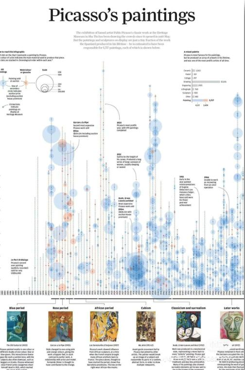

# 毕加索绘画

## 来源

《第三讲-信息图形类型学》PDF 第 11 页，作为相关表现方式的补充案例。图片保留案例图版区域。

## 数据结构

每行记录可识别的作品或观测，另存作品名、图注和来源。 这些字段用于分析和复现图形。

## 图形与阅读方式

点阵展示分布，底部作品缩略图用于定位个案。轴单位与点粒度待原图核实。

## 归类与案例特性

1. **01 数据逻辑**：[编年型信息图形](../../01-%E4%BF%A1%E6%81%AF%E5%9B%BE%E5%BD%A2%E6%95%B0%E6%8D%AE%E9%80%BB%E8%BE%91/01-%E7%BC%96%E5%B9%B4%E5%9E%8B%E4%BF%A1%E6%81%AF%E5%9B%BE%E5%BD%A2%E6%A6%82%E5%BF%B5%E5%AE%9A%E4%B9%89.md)。主图沿创作年份排列，作品名与媒材作为附属分类字段。
2. **02 表现标签**：单一图表型信息图形。[查看同标签案例](./说明.md)。

## 视觉编码

点代表作品，同年点纵向叠置，精选作品以缩略图与注释补充。

## 视觉叙事

先辨年份和点阵密度，再沿标注看具体作品，最后浏览底部精选。

## 制作方法与流程

录入作品ID与年份 → 为同年作品加组内序号 → 高亮指定条目并保留出处。

## 基础数据集

[下载 CSV（可用 Excel 打开）](./03-%E6%AF%95%E5%8A%A0%E7%B4%A2%E7%BB%98%E7%94%BB-%E5%9F%BA%E7%A1%80%E6%95%B0%E6%8D%AE.csv)。表内记录可从图版辨读的数值、文字或对象。字段中若含角色或位置，即为图面观察。 空白表示图版未给出或当前无法核实。 717 为图版正文陈述的数目。可辨的作品名和逐点年份有限，逐点数据仍需更清晰原稿。

| 记录项 | 数值 | 单位 |
| --- | --- | --- |
| 图中文字所述绘画数量 | 717 | 件 |
| 点粒度 | 1 | 件每点 |
