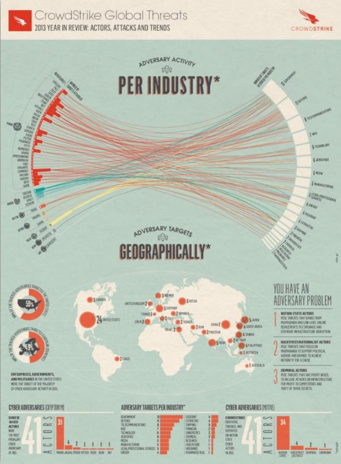

# 行业流向组合图

## 来源

《第三讲-信息图形类型学》PDF 第 36 页，按课件标注归类。图片保留案例图版区域。

## 数据结构

每行一条类别关系，记录起点、终点、量值与时间。 这些字段用于分析和复现图形。

## 图形与阅读方式

流带聚合类别关系，下方小图承载地理和分组背景。

## 归类与案例特性

1. **01 数据逻辑**：[编目型信息图形](../../01-%E4%BF%A1%E6%81%AF%E5%9B%BE%E5%BD%A2%E6%95%B0%E6%8D%AE%E9%80%BB%E8%BE%91/03-%E7%BC%96%E7%9B%AE%E5%9E%8B%E4%BF%A1%E6%81%AF%E5%9B%BE%E5%BD%A2%E6%A6%82%E5%BF%B5%E5%AE%9A%E4%B9%89.md)。主图是类别之间的关系，旁图用地理维度补充，报告年份提供观察范围。
2. **02 表现标签**：编年图+编目混合图。[查看同标签案例](./说明.md)。

## 视觉编码

弧带把左右节点连接起来；带宽的精确定量含义需核原始图例。

## 视觉叙事

先跟踪行业流带，再读地图和下方统计对照。

## 制作方法与流程

整理起点和终点关系 → 有原始值时统一边权单位 → 排列两侧节点并减少交叉。

## 基础数据集

[下载 CSV（可用 Excel 打开）](./02-%E8%A1%8C%E4%B8%9A%E6%B5%81%E5%90%91%E7%BB%84%E5%90%88%E5%9B%BE-%E5%9F%BA%E7%A1%80%E6%95%B0%E6%8D%AE.csv)。表内记录可辨读的标签和图面结构。角色、位置与关系说明依据图面观察。 空白表示图版未给出或当前无法核实。 目前恢复的是关系图的布局单元，左右节点名称及完整边权待更清晰原稿。

| 年份 | 栏目 | 观察对象 |
| --- | --- | --- |
| 2013 | Per Industry | 左右节点 |
| 2013 | Per Industry | 连接带 |
| 2013 | Geographically | 地理标注 |
