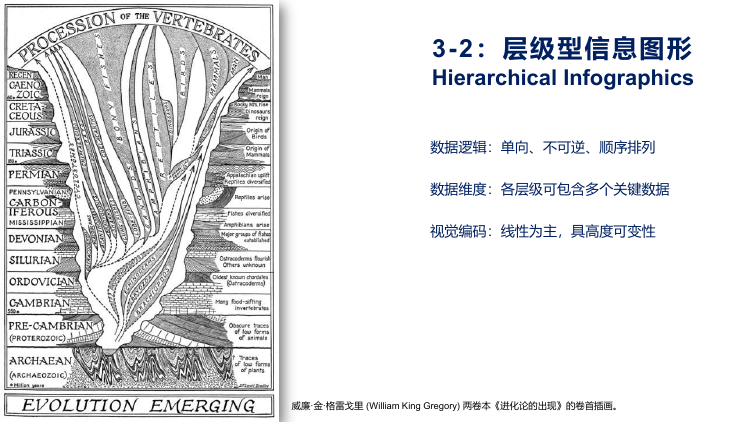
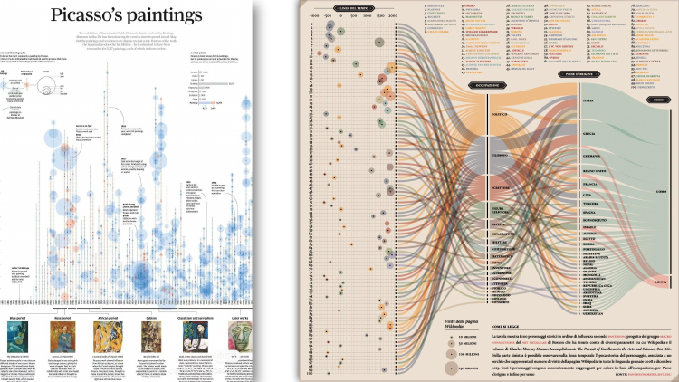
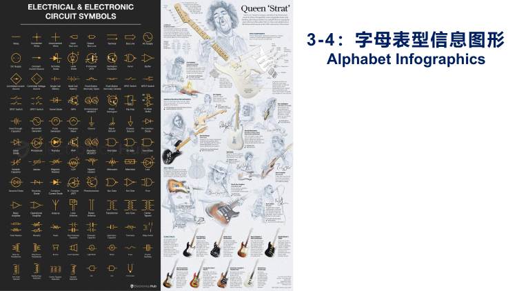

# 信息图形类型案例

案例图片和分析集中在本目录。课件截图依据用户提供的《第三讲-信息图形类型学(1).pdf》，下文页码按 PDF 页序。案例图用来追溯观察，原始数据及作者制作过程需另取证。

- [混合型信息图形](./01-混合型信息图形/说明.md)
- [文字型与列表型信息图形](./02-文字型与列表型信息图形/说明.md)
- [时间轴型信息图形](./03-时间轴型信息图形/说明.md)

## 课件第 6 页：脊椎动物演化

课件注明出自 William King Gregory《进化论的出现》卷首插画。可沿底部到上部的时间层追踪谱系，通过主干和分支看到类群的演化关系。线条粗细的具体统计含义需凭原图图例核实。可复用的方法是把年代与分支关系同时标出，并给分支名称留出排版空间。

## 课件第 11 页：毕加索绘画

分析对象为左图。下方用缩略图与说明提供代表作品入口，上方点阵用位置组织大量对象并穿插局部标注。例图支持“全貌—条目—代表作品”的检索路径。轴的具体单位和每个点的粒度需查原图。

## 课件第 14 页：电路符号表

分析对象为左图。电路符号以分组网格呈现，重复的图样与标签位置便于扫读。可复用的原则是固定符号、名称与类别的位置并明确查找顺序。该课件例图可支持符号索引原则，A–Z 排序规则仍需严格字母表案例补证。
